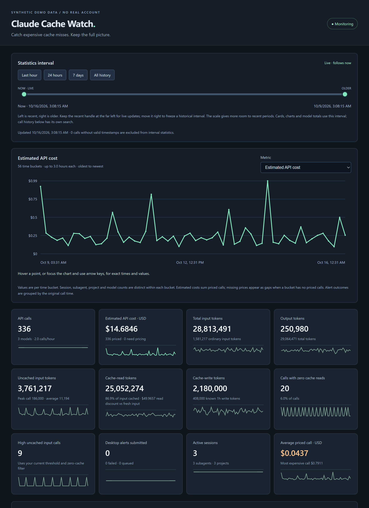

# Claude Cache Watch

A portable Windows tray app for spotting expensive Claude Code cache misses and understanding API usage over time.

It watches local Claude Code transcripts, alerts on high uncached input, and keeps searchable history with estimated API costs. Everything stays on your computer.



*The screenshot uses synthetic data, not a real account's usage or billing.*

## Features

- **Background alerts:** notify when a call's uncached input exceeds your threshold; the default is 100,000 tokens.
- **Call history:** search by session, subagent, project, model or request, with JSON export.
- **Estimated API billing:** separate input, 5-minute/1-hour cache writes, cache reads and output; editable rates for custom models and providers.
- **Session context:** show the parent session title and subagent description where recorded.
- **Live dashboard:** token usage, cache efficiency, cost, alert outcomes, sessions and model breakdowns.
- **Trend charts:** explore 30 metrics with a shared time interval, card sparklines, hover details and keyboard inspection.
- **Portable:** extract and run the Windows x64 EXE; no installer or account connection.

## Get started

1. Download the Windows x64 portable ZIP from this repository's **Releases** page and extract it.
2. Run **Claude Cache Watch.exe**. Windows 10/11 x64 and Microsoft Edge WebView2 are required.
3. Confirm the Claude projects folder. It defaults to `~/.claude/projects`, or `$CLAUDE_CONFIG_DIR/projects` when configured.
4. Use **Test desktop alert** to check notification submission, then leave the app in the tray.

Closing the window keeps monitoring active. Open it again from the tray menu; **Quit monitor** stops the app. Existing logs are imported silently so your first launch does not replay historical alerts.

To start without showing the window:

```powershell
& ".\Claude Cache Watch.exe" --background
```

Releases include a SHA-256 checksum file. You can compare it with:

```powershell
Get-FileHash .\claude-cache-watch-*-windows-x64-portable.zip -Algorithm SHA256
```

## How alerts and charts work

**Uncached input = ordinary input tokens + cache-creation input tokens.** Cache reads and output tokens do not count toward the alert threshold. Exactly 100,000 tokens does not trigger the default alert. Enable **Only when cache reads = 0** to exclude partially cached calls.

The time slider runs from **Now on the left** toward older history on the right. Keep the recent handle at the far left for live updates; move it right to select a fixed historical interval. Cards, trends and model totals use that interval. The chart itself reads chronologically from older to newer. Select a metric, click a card's small chart, or use arrow keys on the main chart to inspect values.

API costs are **estimates**, not invoices or additional charges for a Claude subscription. The app uses published Anthropic rates or your custom rates and shows its assumptions. Unsupported pricing is marked **Pricing needed**. Tax, negotiated discounts, subscription fees and some server-tool charges are excluded.

## Privacy and limitations

The app has no network client or telemetry and does not need an API key. It stores token counters, model/request/session identifiers, project paths, session/subagent titles and alert outcomes in local SQLite history. Full prompts, replies and tool arguments are not stored.

Usage is visible only after Claude Code writes it to a transcript. The app cannot intercept or cancel in-flight calls. Notification banners depend on Windows settings and Focus/Do Not Disturb. History, exports and screenshots can contain private project information; review them before sharing.

See the [detailed usage guide](docs/usage.md) for pricing assumptions, cache rules, startup behavior and history handling.

## Development

Build on Windows with Node.js 20+, Rust/MSVC, Visual Studio C++ Build Tools and a Windows SDK, Git, and WebView2.

```powershell
npm ci
npm run dev
npm run version:check
npm test
npm run check
npm run build
```

Verified portable packages are written to `dist/releases/`. Release builds remap local compiler paths and scan the resulting binary and ZIP before publication.

## Versioning and releases

Versions follow SemVer and stay synchronized across npm, Cargo and Tauri:

```powershell
npm run version:bump -- patch
```

Review the changed version files and add release notes to `CHANGELOG.md`. After you commit, push a matching `vVERSION` tag to run the GitHub Actions release workflow. It validates, tests and builds the app, then publishes a GitHub Release containing the verified portable ZIP and SHA-256 checksum. Prerelease versions are published as prereleases.

Version commands never commit, tag or push automatically. See [development and releases](docs/releasing.md) for CI setup, release retries and the public-data audit.

## License

Licensed under the [MIT License](LICENSE). Copyright (c) 2026 theTd.

[Changelog](CHANGELOG.md) · [Usage guide](docs/usage.md) · [Build and release guide](docs/releasing.md)
